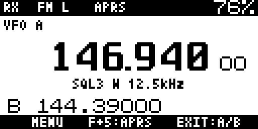
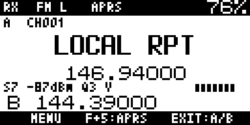
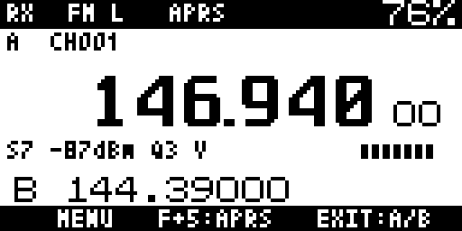
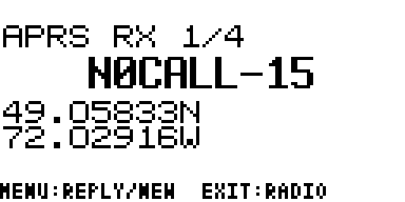
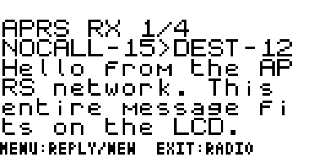

# Validation of the provisional receive prototype

The custom home design is approved. These checks describe the current local prototype,
not an agreed release scope or a published release.

Target: original DP32G030 UV-K5 / UV-K6, Cortex-M0 / ARMv6S-M, Thumb-1,
60 KiB application flash, 16 KiB SRAM. The build target was checked; the user's
physical radio revision was not established.

## Passed in the cloud environment

- Toolchain setup from the pinned Ubuntu image with signed packages: ARM GCC
  10.3.1, ARM binutils 2.38 and newlib 3.3.0. Cached setup was reused successfully.
- Clean default-profile build with the existing warning-as-error flags and LTO.
- Raw flash image **58,036 / 61,440 bytes**, leaving **3,404 bytes**.
- Static `.data` + `.bss`: **7,188 bytes**. Linker stack reservation: **2,048
  bytes**. The startup vector sets SP to **0x20003ff0**, preserving upstream's
  16-byte top-of-SRAM reserve. 9,180 bytes lie between static data and that SP;
  this is not a measured maximum stack margin.
- ELF CPU attributes, Thumb reset vector, RAM/flash bounds and packed updater
  version/payload/CRC. Unpacking reproduced the exact raw image.
- Host tests with assertions, AddressSanitizer and UndefinedBehaviorSanitizer
  enabled against the actual parser/receiver/compressor/squelch/UI source:
  - Known AX.25 FCS vector; UI-frame parsing, both NRZI polarities, HDLC bit
    stuffing, truncated/corrupt data and non-APRS control/PID rejection.
  - Uncompressed, timestamped, compressed and Mic-E position fixtures,
    geographic bounds, addressed messages, full 67-character text, sanitization.
  - 20,000 deterministic malformed frame/capture cases.
  - Simulated BK4819 register setup/restore, RX/TX/scan/dual-watch/sleep/serial/
    modulation exclusion, FIFO → HDLC → decoded position → bounded history.
  - Compressor gain bounds, reserved register bits, restoration and FM-only gate.
  - Adaptive squelch voice bias, scan exclusion and baseline restoration.
  - Browser navigation, PTT passthrough, real framebuffer rendering and UI fallback.
  - Message banners, default-ON/muted alert dispatch, PTT cancellation, expiry
    while RX is off and receiver rearming after the mocked shared audio path.
    The alert uses the existing optional-beep API, respecting global beep OFF.
- The isolated TX size experiment was reproduced separately. Its result and
  upstream tone compatibility issue are documented in `APRS-TX-INVESTIGATION.md`.

The FIFO/register simulator exercises the firmware's control flow. It does not
simulate BK4819 analog/RF behavior or establish APRS reception on a real radio.
The position tests use synthetic protocol fixtures, not captured on-air traffic.

## LCD examples

These are generated by the actual host-tested display code using mock radio
state. They are not photographs of a physical radio. Regenerate them with
`./tools/test.sh && python3 tools/render-previews.py`.

## Unrun or limited

- Physical boot, flashing/recovery and individual MCU compatibility.
- RF APRS decoding, sensitivity, timing, interoperability and packet-loss rate.
- Voice audio/deviation, compressor calibration, real squelch/scan performance,
  current consumption, maximum stack depth and long-running stability.
- Physical operation of the custom UI and nondefault feature-flag combinations.
- APRS TX in the default image; the small size prototype is not an operational
  or RF-validated transmitter. APRS transmit remains a development goal.

The GitHub Actions workflow repeats the default software checks on future
pushes. A local passing run is not a claim that a remote CI run has passed.
See `HARDWARE-VALIDATION.md` for the outstanding physical test procedure.

## Standard TX waveform experiment

The separate `experiments/bell202_symbols.c` protocol encoder generates FCS,
HDLC stuffing and NRZI symbols without linking into the firmware. Python turns
those symbols into continuous-phase, ideal 48 kHz audio at 1200/2200 Hz.
`tools/test-bell202.py` uses independent Dire Wolf `atest` with bit repair OFF.
Position, addressed message, ACK/reject and stuffing-heavy full-length message cases decode;
corrupted-symbol cases must fail CRC and produce zero packets. Logs and WAVs
are under ignored `build/bell202/`. These are synthetic fixtures, not recordings.

This establishes protocol/audio encoding only. No BK4819 radio output, MCU timer backend, RF deviation, AX.25 message retry
logic or hardware interoperability is validated by this experiment. Dire Wolf is an
optional investigation dependency, not needed for the default build/tests.

## Approved editor candidate

The additional host suite compiles the real editor and UI with
`ENABLE_APRS_MESSAGING`. Multi-tap/timeout/delete, quick-message insertion,
67-character bounds, draft preservation, review/back/send-block behavior and
actual key/PTT integration pass with ASan/UBSan. Protocol helper tests cover
callsign/SSID/ID validation, message construction, receive-parser roundtrip and
ACK/rejection correlation including SSID zero. The independent audio test's
ordinary message is built with the actual C message builder before encoding.
These are software checks, not successful radio messages. The current candidate
with session inbox/monitor is 63,000 bytes (1,560 over flash); see `MESSAGING-IMPLEMENTATION.md`.

The session-profile/inbox candidate additionally passes own-call keypad entry,
validation/save/cancel, own-address filtering, SSID-zero normalization, unread
tracking and bounded eviction. Unrelated traffic leaves personal storage intact
and still triggers banner/sound. New arrivals preserve an open message until
its eviction, then return to the list. Position and quick-message RAM setters
reject invalid input without partial changes. No hardware power-cycle claim is
made; the profile code contains no EEPROM accesses.

## Flash feasibility optimization

Compressed-coordinate scaling now uses exact bounded 32-bit arithmetic. The
exhaustive C test compares 137,133,362 valid input/divisor pairs with the former
64-bit expression. It passes, and all parser, receiver, editor and UI sanitizer
checks pass after this change. That optimization saved 612 flash bytes with static RAM unchanged. Subsequent
shared UI and lossless resource work produced the current totals above. The original-MCU ELF/vector/budget and updater checks pass.

The static-beacon builder passes coordinate/hemisphere bounds, nearest-hundredth
minute rounding and degree-carry tests. The independent waveform test now uses
the actual C beacon builder as well as the actual C message builder before the
C HDLC/NRZI encoder. Positive and corrupted-frame cases pass in Dire Wolf.
No actual RF, timer, retries or radio handoff is tested by this waveform.

The retained-protocol diagnostic build is 65,028 bytes, 3,588 over the real
application region, and still excludes the operational radio driver/service.
See `FLASH-FEASIBILITY.md`; no larger diagnostic linker region is a hardware fix.

## Shared home screen and lossless resources

The single home rendering path covers scan/direction/rate, numeric entry, split,
toast, VFO warnings, DTMF activity and bandscope overlays. Real main-screen tests
also verify low-battery/key-lock/APRS priority, invalid VFO indices, refresh
conditions, calibrated RSSI and degenerate S0/S9 calibration without division by
zero. Radio scan/PTT algorithms were not replaced.

All original font bytes (plain and optional bold) and menu hint bytes are
compared against the expanded resources under sanitizers. Twelve full-candidate and eleven receive-session actual
framebuffer states are identical with packed and unpacked fonts. Compression
trades flash for RAM; the current build has 7,188 static RAM bytes, excluding its
2,048-byte stack reservation. Runtime maximum stack usage is unmeasured.

The messaging candidate additionally passes station deduplication, retained
positions, age counters and stable selection/eviction; repeated personal
messages with identical source/ID/text do not consume another inbox slot.
Received ACK/reject controls are parsed and correlated without generating text
message alerts. The sender/ID/wait-state helpers remain simulated until a real
transport is connected.

The separate experimental timing scheduler uses absolute 40,000-cycle deadlines
at an assumed 48 MHz. Host tests cover maximum stuffed frames, 32-bit clock wrap,
cancellation and excessive latency/jitter. This scheduler is not linked to radio
output; simulated timing is not hardware timing validation.

## Experimental radio handoff and frozen outbox

The actual experimental modules pass sanitizer tests for tone selection, shared
register/mute restoration, TX prerequisites, disabled/wrong-period clock rejection,
physical-PTT/timeout/timing-fault cancellation, explicit enable, stationary
simplex admission and complete PA-ramp/RX cleanup. These tests replace hardware
registers/radio entry points; they do not establish analog behavior or real RF.
The C backend and owner also cross-compile for ARMv6S-M/Thumb-1.

The frozen outbox passes one/three-attempt policies, busy deferral, sender/peer/ID
matching, cancellation, expiry and tick wrap. No new draft can overwrite an active
job. ACK deadlines begin after successful simulated handoff. Retry selection and
automatic ACK policy are not inferred from these tests; the operator flow remains
unconnected and the modules are absent from the default image.

The additional transport tests cover frozen requested frequency and refusal
when the actual VFO changes, local received-frequency metadata, immediate RX
rearming without timer/alert changes, matching late ACKs, independent control
FIFO ordering/deduplication/full/expiry behavior, wrapping deadlines, busy
controls without starving own-job expiry, and whole-TX cancellation. No packet
currently triggers automatic RF acknowledgment in the normal firmware.

The retained owner/transport diagnostic is 67,740 bytes, 6,300 over the physical
application limit, and still misses remaining configuration/send integration.
The current default receive binary is 58,036 bytes; its updated hashes are in
`receive-build-verification.json`. The frozen published bench remains unchanged.

## Fitting receive-session bench image

`tools/build-receiver-bench.sh` now passes the real linker/vector/architecture,
RAM/stack and updater-payload/CRC checks at **61,388 bytes**, 52 free. Static RAM
is **7,996 bytes**, plus the 2,048-byte reserved stack. Its raw hash is
`ee0cfb450bc8aeff08e02a90435a359b14a27ee21315b08f69eb3d1e7a2afaa2`;
packed hash is `0b581b1365637f289bb1eec60bdacf0f9b0aca2b48d89873b670a728bb8f674c`.
The verified hardware target is original DP32G030; no individual radio revision
or RF behavior is established by this check.

This profile includes the approved home/overlays, station directory/positions,
personal inbox and monitor with session-only callsign entry, and all radio
features of the current default. Composition remains available in its separate
full development profile. APRS transmit remains in development. Twelve full
candidate and eleven receive-session framebuffers compare byte-for-byte between
raw and packed fonts, including actual callsign entry. Receive-session tests
also verify that the hub/monitor expose their implemented controls and PTT works.

Host captures are under `screenshots/receiver-bench/`; they are not photographs.
The package's manifest links the exact corresponding source and identifies
whether its build tree was clean. Published bench artifacts must have a clean
source tree and matching raw/packed hashes. Physical validation remains unrun.

The published raw and packed images were fetched from their immutable GitHub
URLs and matched the manifest hashes. A fresh source archive of commit
`d8b8b3d1119b66d1ed177e2dd32a81f9003e0b8a` then rebuilt both files byte-for-byte
with the manifest's 46 pinned boolean settings. `tools/verify-bench-release.py`
reproduces this check without altering the working checkout. The CI workflow
also runs it against the frozen published source while development continues.
The artifact-publication commit's initial GitHub run 39289755235 passed host
tests and both real-limit build/package checks; later workflow results must be
checked separately. None of these checks is a physical radio/RF test.

## Resource-parser follow-up

Minimum-byte LZSS token selection retains the existing on-radio format/decoder.
The complete sanitizer suite, plain/bold font bytes, all hints and actual LCD
frame comparisons pass. A further 65 deterministic generated streams decode
with the actual C decoder under ASan/UBSan, checking exact output and untouched
output guards for empty/short, repeated, overlapping, random and window-boundary
inputs. The development bench passes real flash/RAM/vector/updater checks at
61,368 bytes; the previously published 61,388-byte bench and its manifest remain
frozen. `tools/test-packer.py` reproduces the new stream cases.

## Approved session service and separate-channel model

The real experimental service passes sanitizer tests for default-disabled TX,
validated enable, personal automatic ACKs/SSID-zero matching, other-addressee
and wrong-frequency exclusion, duplicate/full queues, three total attempts,
frequency-matched delivery evidence, beacon position requirements, atomic invalid
configuration and cancellation on disable/identity changes. Pending control
replies do not overwrite an own message or its acknowledgment deadline.

The channel model passes tune-before-send and restore-after-send checks with
injected operations. The configurable ACK deadline defaults to ten seconds
**after** handoff; ACK/reject, PTT, expiry, fault and disable restoration are tested,
including wrap, control replies during a wait and interruption during acquisition.
The hardware enter/restore adapter and normal UI/RX/foreground calls are absent.
No channel switching, APRS RF output or physical backup has been verified.

The retained service/model cross-compiles at 68,560 bytes; a separately generated
model-bound service copy measures 67,692 bytes with 8,608 static RAM. Neither
fits or contains an actual channel-retuning adapter. Its copied hooks are for
size diagnosis, not an implemented normal build. The baseline, protocol and tone
owner phases remain separately reported. No diagnostic linker enlargement is a
hardware-capacity change.

The local raw-EEPROM consistency checker was exercised with matching full-size
fixtures and rejects truncated, mismatching and uniform-calibration fixtures.
It does not validate a connected radio, every calibration field, or recovery.
No owner backup exists in the workspace. The corrected installation-preparation
guide distinguishes charging USB-C from two-pin serial programming, EEPROM reads
from firmware dumps, and MCU evidence from model/version labels.

Windows preparation now uses the official CHIRP Egzumer download path, whose
source reads the full 8 KiB image. The checker additionally accepts recognized
CHIRP UV-K5 images with valid trailers, comparing EEPROM payloads independently
of metadata. Local fixtures confirm matching payloads with different valid
metadata pass and missing/invalid trailers fail. These tests do not establish a
real radio backup or Windows serial connection; no such hardware is connected.

## Shared implementation regression checks

The compact formatter passes 158,208 original-output/truncation comparisons,
plus an INT_MIN boundary check against libc. The settings loader matches the
original across 56,576 EEPROM images in each of three configurations with
ASan/UBSan and a mock that rejects EEPROM writes. All 56 stored LCD framebuffer
comparisons remain identical after the formatter and shared APRS row changes.
The full host suite passes. Default RX and RX-session images were rebuilt and
verified sequentially; the complete transport build remains oversized at
66,796 bytes. These checks do not establish physical/RF interoperability.

## Packed display resources

The production resource stream expands exactly to all 234 display literals,
921 hint bytes and 15 original compiled fixed-width choice tables, including
their zero padding and dimensions. Literal offsets are verified as C constant
initializers; unregistered literals must fail compilation. ASan/UBSan and
the complete host suite pass, and all 56 stored LCD comparisons remain identical.
The original-MCU default RX and RX-session builds verify at 53,632 and 56,308
bytes respectively. The complete transport profile remains oversized at
65,752 bytes with 11,644 static RAM bytes plus 2,048 reserved stack bytes.
No RF or physical-radio test was performed.

## Compact runtime checks

Memory/string helpers pass 1,374,283 libc comparison cases under ASan/UBSan.
The application suite runs their same bodies under test-prefixed names to
avoid interposing on sanitizer internals. Compact division passes 10,390,468
native oracle checks and 1,924 Cortex-M0 vectors through original and replacement
runtime entry names and compiler-generated consumers. The real SysTick ISR
passes 1,033,250 cadence/wrap/timeout checks with division removed from the IRQ.
The complete host suite and 56 stored LCD comparisons pass. Current verified
RX/RX-session images are 52,380/54,936 bytes; the complete transport is still
oversized at 64,388 bytes. No physical RF/hardware validation was performed.

## Shared rendering and formatting checkpoint

The complete host suite passes with ASan/UBSan. A retained original menu
renderer matches **16,002 frames and hardware preview traces** across all
menu entries, settings, browsing/edit states, confirmations and categories.
The shared degrees/minutes formatter passes **2,164,390 comparisons** with
the prior printf formatting path, including lengths and output bounds. All
56 stored radio/APRS LCD frames are unchanged.

Sequential verified builds measure default RX **52,068 bytes**, RX-session
development **54,492 bytes**, full transport **63,832 bytes** (2,392 over).
The full candidate remains non-flashable. Frozen release files are unchanged;
physical RF and radio hardware remain untested.

## Complete original-MCU fit

The full APRS transport candidate passes the unchanged production linker at
**61,440 bytes**, with **12,268 static RAM bytes** and a **2,048-byte stack
reserve**. ARMv6S-M/Thumb-1 vectors, all flash LOAD ranges, updater payload/CRC
and SRAM reservation checks pass. No additional feature removals were made.
The minimal RX profile uses 49,888 bytes and the current RX-session profile
52,448 bytes; the older frozen bench image remains unchanged.

The full ASan/UBSan application suite passes. Additional differential checks:

- 583,680 bounded and 6,080 unbounded comparisons of every source buffer format;
  158,208 checks of the retained broader formatter and source-format validation.
- 16,002 default and 16,020 voice-enabled complete menu frames/preview traces.
- 56,760 settings/getter/side-effect cases in each default/voice configuration,
  plus all 256 menu IDs and their bounds.
- 9,885 original tone-table, Golay/rotation and nearest-tone comparisons.
- 2,072,020 original calling-band lookups, inclusive edges and channel parameters.
- 131,584 BK4819 and 131,072 I2C original pin-state/programmed-delay traces.
- 152 guarded exact Huffman/LZ streams and all original glyph/text bytes;
  actual font/text expansion also passes on a Cortex-M0 CPU model with 16 KiB RAM.
- 2,164,390 shared coordinate-format comparisons and all 56 stored LCD snapshots.

These augment the existing decoder, runtime, RF-adapter, timing-fault, restoration,
ACK/retry, compact memory and Cortex-M0 arithmetic/ABI checks. CPU modeling and
pin traces do not establish physical RF timing, deviation, interoperability,
boot or recovery. No hardware was flashed. See [FINAL-FIT.md](FINAL-FIT.md).

## Egzumer updater limit correction — revision 2

The initial full candidate's 61,440 bytes passed physical flash checks but exceeded
the updater's 61,439-byte guard. Revision 2 is **61,432 raw / 61,450 packed bytes**,
with unchanged features and RAM. The build verifier now enforces the updater
limit as well. Native guarded resource streams and Cortex-M0 font/text execution
pass after the eight-byte decoder saving. Actual pinned upstream unpacking,
repacking, size guard and all flash packets pass with serial mocks; physical
flashing/RF remain untested. See [FINAL-FIT.md](FINAL-FIT.md).
